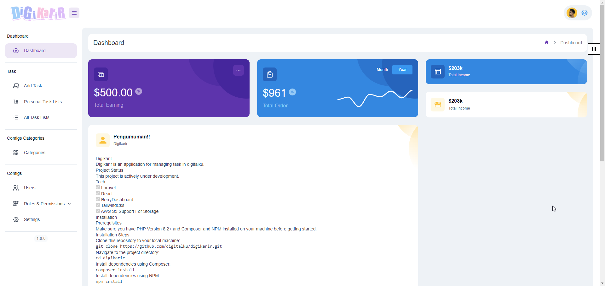

# Digikarir

Digikarir is an application for managing task in digitalku.



## Project Status

This project is actively under development. 

## Tech
- [x] Laravel
- [x] React
- [x] BerryDashboard
- [x] TailwindCss
- [x] AWS S3 Support For Storage

## Installation

### Prerequisites

Make sure you have PHP Version 8.2+ and Composer and NPM installed on your machine before getting started.

### Installation Steps

1. Clone this repository to your local machine:

    ```bash
    git clone https://github.com/digitalku/digikarir.git
    ```

2. Navigate to the project directory:

    ```bash
    cd digikarir
    ```

3. Install dependencies using Composer:

    ```bash
    composer install
    ```

4. Install dependencies using NPM:

    ```bash
    npm install
    ```


5. Copy the `.env.example` file to `.env`:

    ```bash
    cp .env.example .env
    ```

   Note : change `FILESYSTEM_DISK` dari `local` ke `s3` untuk menggunakan penyimpanan aws
   Jika Menggunakan AWS jangan lupa setting :
   ```
   AWS_ACCESS_KEY_ID=
   AWS_SECRET_ACCESS_KEY=
   AWS_DEFAULT_REGION=us-east-1
   AWS_BUCKET=
   AWS_USE_PATH_STYLE_ENDPOINT=false
   ```

6. Generate the application key:

    ```bash
    php artisan key:generate
    ```

7. Set up the database connection in the `.env` file.

8. Run migrations to create the database structure:

    ```bash
    php artisan migrate
    ```


9. Change Username and password admin:

    ```bash
    /database/seeders/UserSeeder.php
    ```
   (Default Tanpa Dirubah) :
   Username / Password = admin / password

10. Add Data To Database
 
   ```bash
   php artisan db:seed
   ```

11. Start the local server [Tidak Perlu Dijalankan di production]:

    ```bash
    php artisan serve
    ```

The project can now be accessed at [http://localhost:8000](http://localhost:8000).

## Feature
- [x] Mobile Support (PWA)
- [x] Login with Remember
- [x] Logout
- [x] User Management (Create, Update, Delete)
- [x] Role Management (Create, Update, Delete)
- [x] Role Permission (Update)
- [x] Category Management & Permission (Create, Update, Delete)
- [x] Custom Category Field (Create, Update, Delete)
- [x] Custom Category Option (Create, Update, Delete)
- [x] User API Generate (Create, Update, Delete)
- [x] User API Generate (Create, Update, Delete)
- [x] Task Management (Create, Update, Delete)

- [ ] Pusher Notification
- [ ] Absent Management System
- [ ] System 


## Contribution

Thank you for considering contributing to the Laravel framework! The contribution guide can be found in the [Laravel documentation](https://laravel.com/docs/contributions).

## License

This project is licensed under the [MIT](https://opensource.org/licenses/MIT). 

